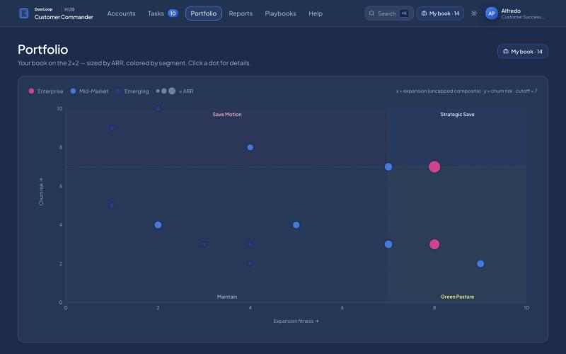
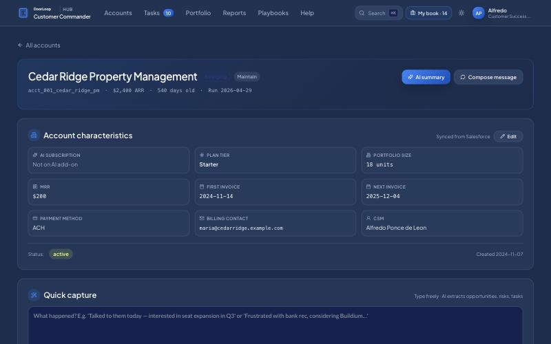
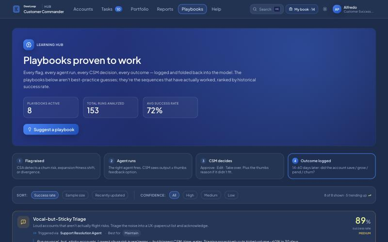

# Customer Commander (CS agent system prototype)

**Jul 2026 · Customer Success Managers and stakeholders**

## Problem

The company was designing an AI agent system for Customer Success, with Slack as its first interface. Specs alone didn't show CSMs what it would do for them day to day, or how they would stay in control of it.

## What I built

A clickable front-end prototype of the CSM's workspace, on synthetic data:

- **My book.** The CSM's accounts and how many need attention this week, grouped by playbook: save motion, strategic save, maintain, green pasture, and silent churners.
- **Portfolio.** Every account on a 2×2 of churn risk against expansion fitness, sized by revenue and coloured by segment. Clicking a dot opens the account.
- **Account page.** The account's characteristics, an AI summary, a message composer, and a quick-capture box: the CSM types what happened, and AI pulls out opportunities, risks and tasks.
- **Tasks.** What the agents suggest, waiting for the CSM to approve, edit or take over.
- **Playbooks.** A learning loop: a flag is raised, an agent runs, the CSM decides, and the outcome is logged 14–60 days later. Playbooks are ranked by how often they actually worked, with sample size and confidence shown.
- **Reports, workflow admin and settings** to show how the system would be run and tuned.

## Decisions worth explaining

- **Two scores instead of one.** A single health score hides the difference between "at risk but growing" and "safe but flat". The quadrant makes the right playbook visible.
- **The CSM stays the decision-maker.** Agents propose and the CSM approves, edits or takes over. Every decision is logged so the system can learn from it.
- **Rank playbooks by evidence.** Each playbook shows its success rate with sample size and confidence, so a high rate on a few accounts isn't oversold.
- **An alignment tool, not a product.** The goal was to get people reacting to something concrete before engineering time was spent. The README says plainly what the prototype is not.

## How I built it

React and TypeScript in strict mode, Tailwind and Recharts, with no backend. JSON fixtures follow the schema the production system would produce. I wrote the spec and design references first, then built it with Claude Code.

## Stack

React 18, Vite, TypeScript, Tailwind CSS, Recharts, Lucide icons.

## Talking points

- Prototyping to align people on an AI system before it exists.
- Designing human-in-the-loop controls so people trust agents.
