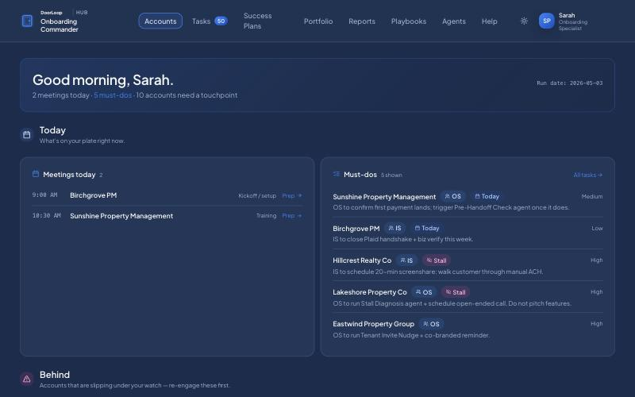
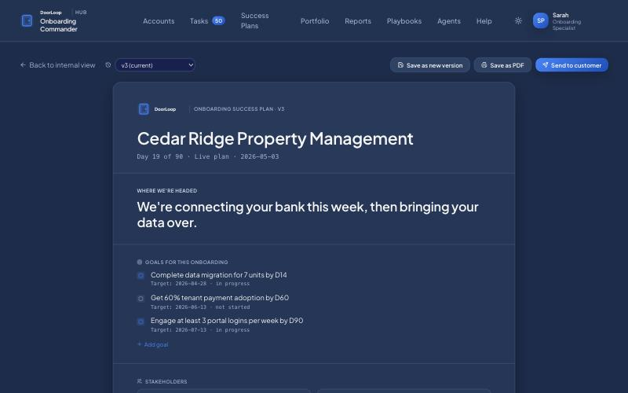

# Onboarding Commander (onboarding agent system prototype)

**Jul 2026 · Onboarding and Implementation specialists**

## Problem

The first 90 days decide whether a customer stays. Onboarding work was split between two roles: an onboarding specialist who owns the relationship and outcome, and an implementation specialist who handles payments setup, business verification and data entry. Neither had one view of what each account needed next.

## What I built

The onboarding sibling of [Customer Commander](07-customer-commander.md). Same architecture and design, different lens, all on synthetic data:

- **Today.** Meetings, and must-dos tagged by role (onboarding or implementation) with priority, plus a "behind" list of accounts slipping.
- **Portfolio.** Every account in onboarding on a 2×2 of activation velocity against setup completeness: behind, plateau, building, ready.
- **Customer-facing success plan.** A versioned plan per account: where we're headed, goals with target dates, and stakeholders. It can be saved as PDF or sent to the customer.
- **Agent library.** Each onboarding agent with what it does, when it fires and how many accounts it would help right now. Examples are a tenant-invite nudge, banking setup help, merchant account recovery and data migration help. Any agent can run across several accounts at once.
- **The 90-day frame.** Three milestone checkpoints, with graduation to Customer Success when onboarding closes.

## Decisions worth explaining

- **Two roles, both accountable through day 90.** The prototype tags every task with who owns it, so handoffs between the two roles are explicit.
- **The plan is a deliverable, not a note.** Customers see the same goals the team tracks, and every version is kept.
- **Agents are aimed at the friction points.** Each agent maps to a known place where onboardings stall, and shows how many accounts it applies to before anyone runs it.
- **Build the sibling, don't fork the idea.** Reusing the CS prototype's structure meant the two teams saw one system with two lenses.

## Stack

React 18, Vite, TypeScript, Tailwind CSS, Recharts.

## Talking points

- Designing for a two-role workflow without letting work fall between the roles.
- Turning internal tracking into something the customer sees.
